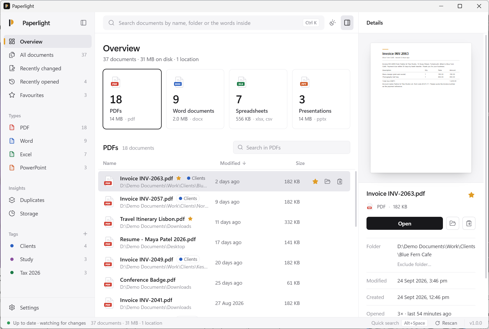
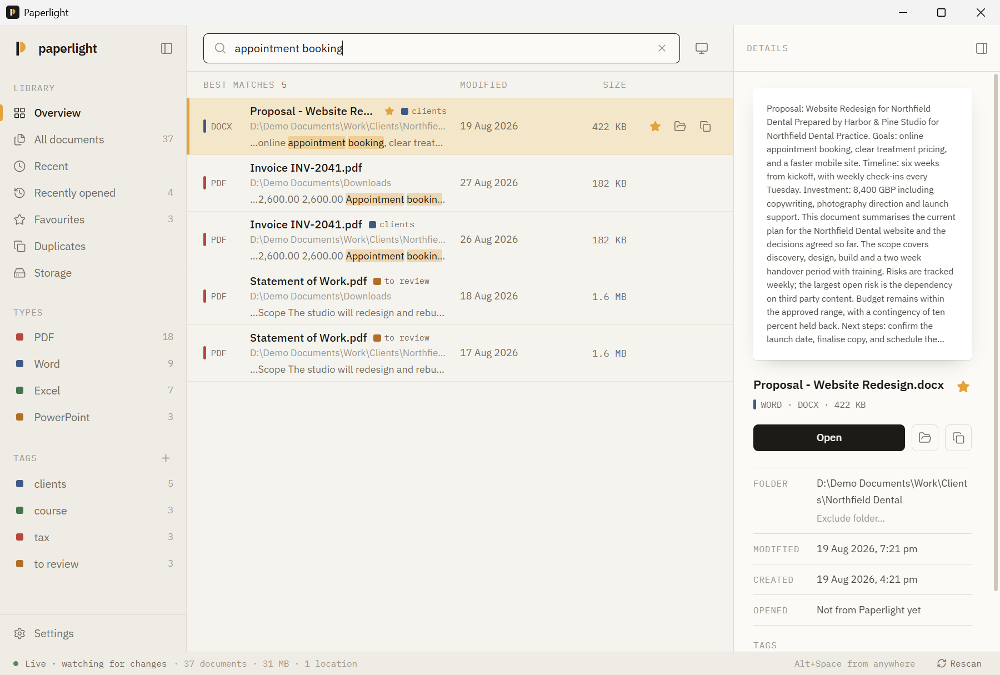
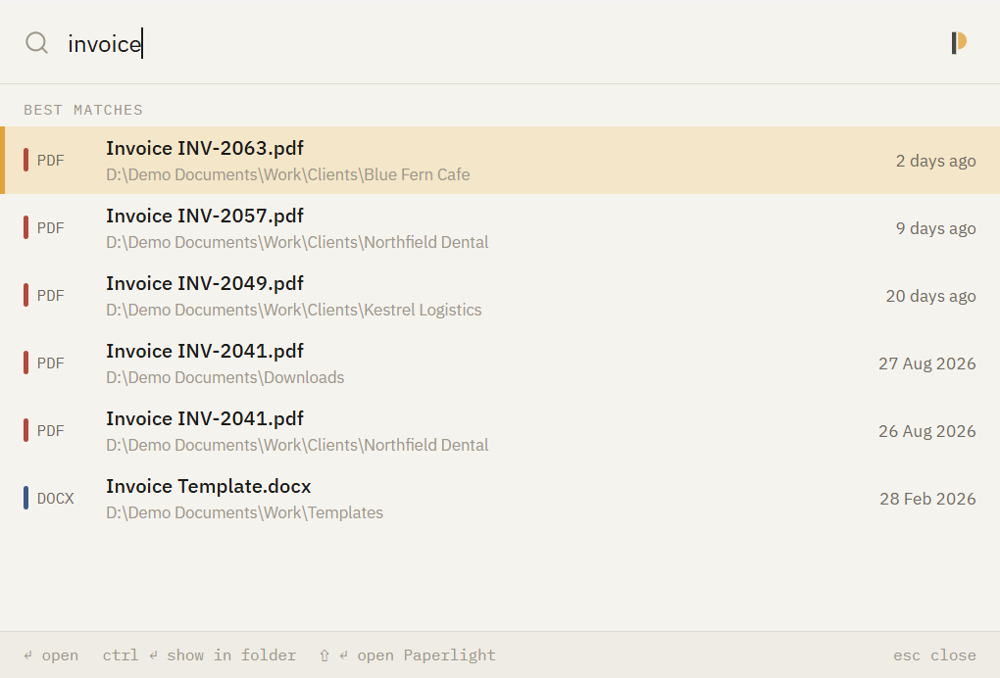
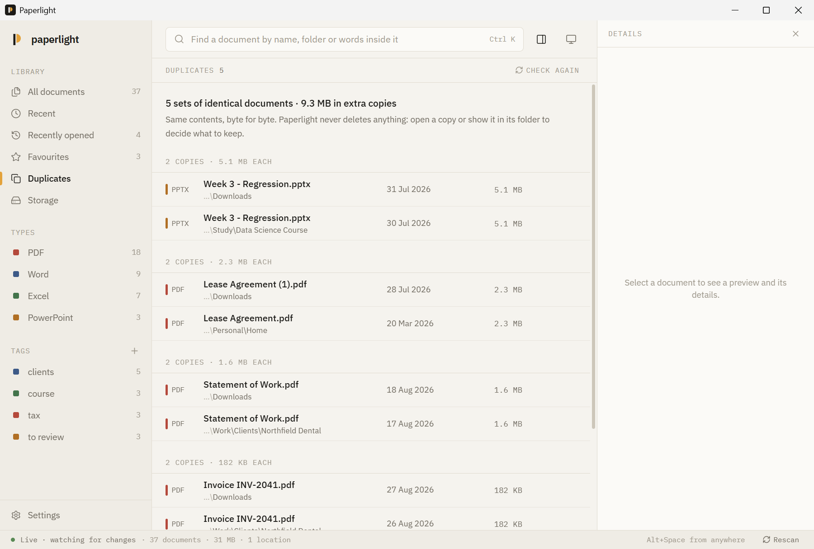
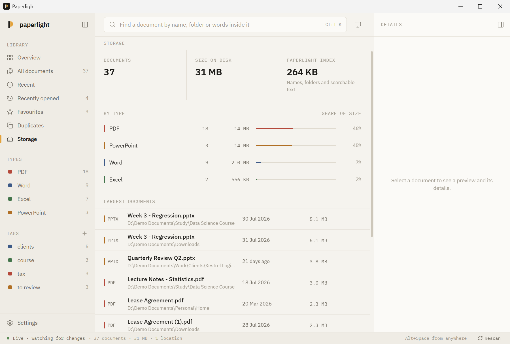
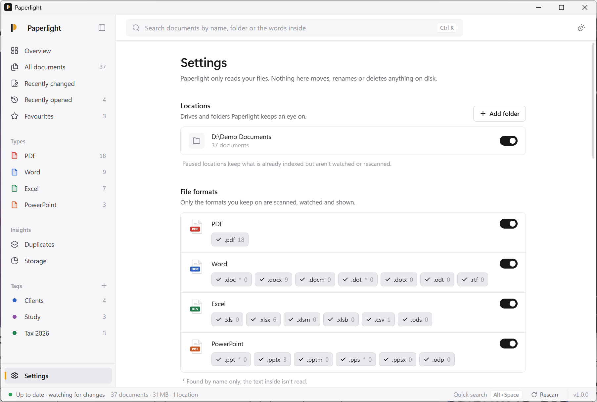
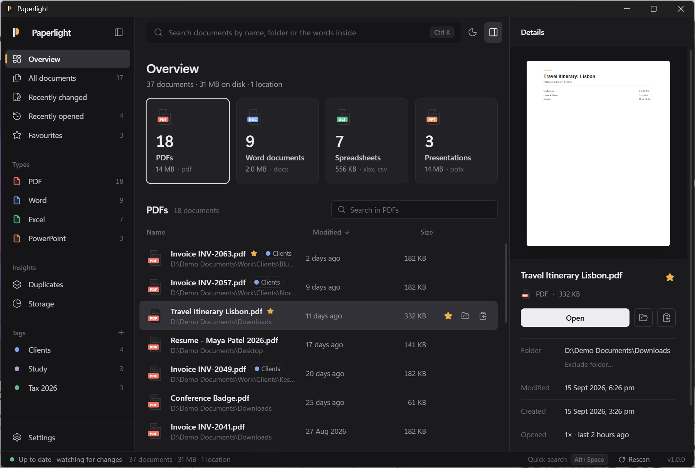
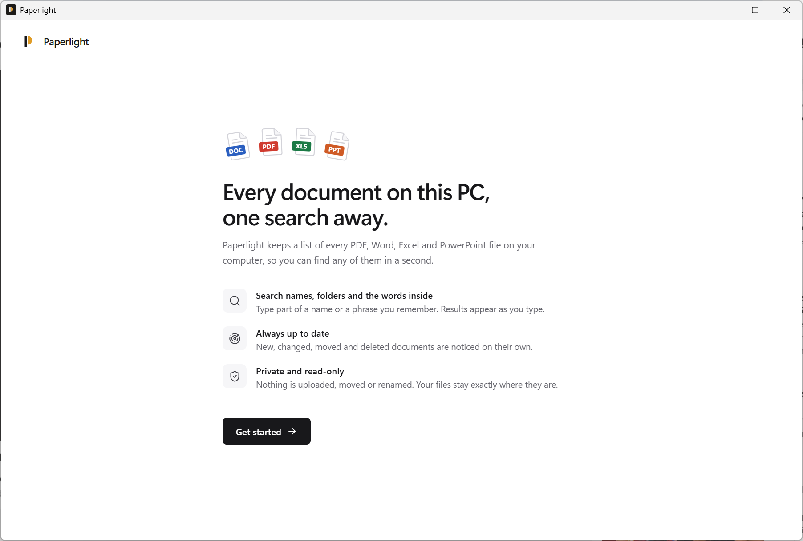
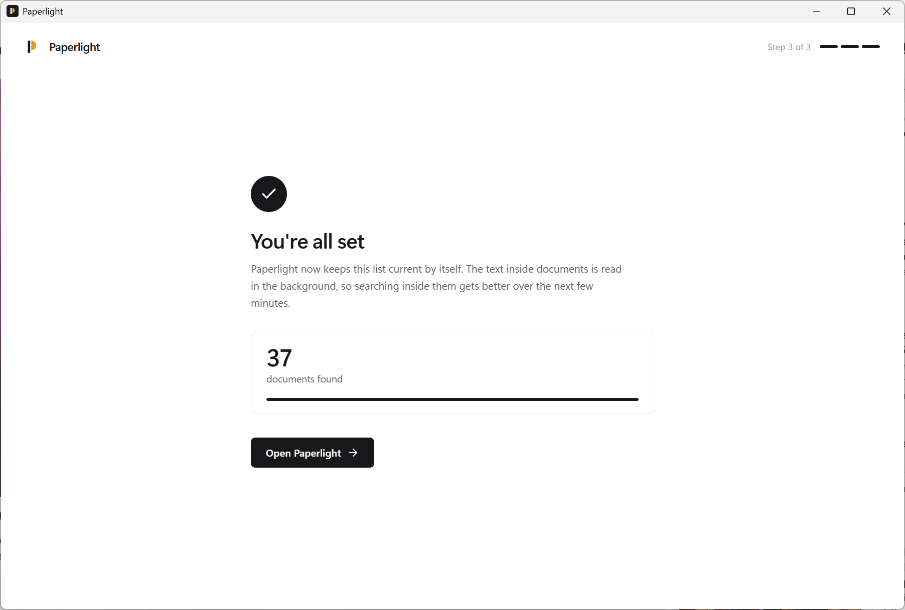
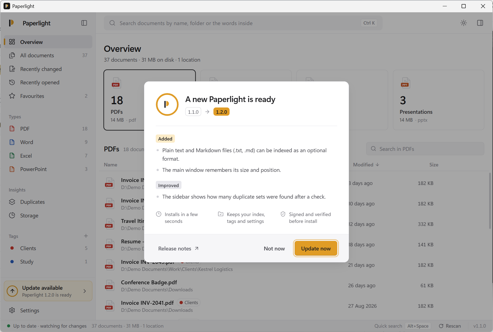

<p align="center">
  
</p>

<h1 align="center">Paperlight</h1>

<p align="center">
  <b>Every document on your PC, one search away.</b><br>
  Find any PDF, Word, Excel or PowerPoint file by name, folder or the words inside it.<br>
  Fast, private, and it never touches your files.
</p>

<p align="center">
  <a href="https://github.com/webKing021/paperlight/releases/latest"><b>Download for Windows</b></a> ·
  <a href="#linux-beta">Linux (beta)</a> ·
  <a href="#features">Features</a> ·
  <a href="#paperlight-or-something-else">Compare</a> ·
  <a href="CONTRIBUTING.md">Contribute</a>
</p>

<p align="center">
  <a href="https://github.com/webKing021/paperlight/releases/latest"></a>
  <a href="https://github.com/webKing021/paperlight/actions/workflows/ci.yml"></a>
  <a href="LICENSE"></a>
</p>



[](https://www.youtube.com/watch?v=vAPLSGX4Teg)

## Why

Documents pile up everywhere: Downloads, Desktop, project folders, old drives. You remember
what a file was about, not where you saved it. Paperlight indexes them all once, keeps up as
they change, and finds any of them in milliseconds.

## Features

- **Search inside documents.** Names, folders and the text of PDFs, Word, Excel and PowerPoint
  files, typo-tolerant, with the matching passage highlighted. Whole documents, not just the
  first pages.
- **Drag it where you need it.** Drag a result into an email, a chat or a folder, or copy the
  file with <kbd>Ctrl</kbd>+<kbd>C</kbd>.
- **Buckets.** One tile per document type: PDFs, Word documents, Spreadsheets, Presentations,
  each with its own search.
- **Quick search from anywhere.** <kbd>Alt</kbd>+<kbd>Space</kbd> in any app (or a hotkey you choose), then <kbd>Enter</kbd> to open.
- **Always current.** New, renamed, moved and deleted files show up within a second.
- **Organise without touching files.** Favourites, tags, recently opened, previews.
- **Duplicates and storage.** Find byte-identical copies and see what takes space.
- **You choose what's indexed.** Pick the file formats and folders; skip the rest.
- **Updates itself, if you want.** New versions install from inside the app in a few seconds,
  keeping your index, favourites and tags. Paperlight works offline either way.
- **At home on Windows.** A native look, light and dark themes (title bar included) and a
  short welcome that sets everything up on first run. A [Linux beta](#linux-beta) is
  available too.

## Paperlight or something else?

There are good search tools already. Which one fits depends on what you are looking for:

- **Any file, by name:** [Everything](https://www.voidtools.com/) lists every file on your
  drives instantly. Use it when you know the name. Paperlight only looks at documents.
- **The most formats, OCR, advanced queries:**
  [DocFetcher](https://docfetcher.sourceforge.io/), [AnyTXT Searcher](https://anytxt.net/)
  and [Recoll](https://www.recoll.org/) are mature full-text tools that read more formats
  than Paperlight does.
- **Paperlight** is the small, quiet one for everyday documents: a ~5 MB download, nothing
  to configure, no background service, an index that follows your files as they change, a
  launcher on a hotkey, and all of it open source under MIT. It reads PDF, Word, Excel and
  PowerPoint (and plain text if you turn it on), and it does not do OCR.

## Screenshots

| Search inside documents | Quick search (<kbd>Alt</kbd>+<kbd>Space</kbd>) |
|---|---|
|  |  |
| **Duplicates** | **Storage** |
|  |  |
| **Settings: formats and folders** | **Dark theme** |
|  |  |
| **Welcome on first run** | **Set up in a minute** |
|  |  |

**Updates from inside the app**



## Install

1. Download `Paperlight_x.y.z_x64-setup.exe` from the [latest release](https://github.com/webKing021/paperlight/releases/latest).
2. Run it. Windows 10/11, 64-bit; no admin rights needed. SmartScreen may warn because the
   installer isn't code-signed yet: *More info → Run anyway*.
3. The welcome screens walk you through setup: pick the drives or folders to index, choose a
   few preferences and press **Start indexing**. Paperlight is usable while the first scan runs.

### Linux (beta)

Each [release](https://github.com/webKing021/paperlight/releases/latest) also has Linux
packages for x86-64, built on Ubuntu 22.04:

- **Debian, Ubuntu, Mint:** `sudo apt install ./Paperlight_x.y.z_amd64.deb`
- **Fedora, openSUSE:** `sudo dnf install ./Paperlight-x.y.z-1.x86_64.rpm`
- **Anything else:** make the `.AppImage` executable (`chmod +x`) and run it. It is much
  larger than the packages because it carries its own web engine.

It is a beta. On Linux, Paperlight doesn't update itself yet (install the newer package over
the old one; your index, favourites and tags are kept), the quick-search shortcut needs an X11
session, the tray icon needs a desktop that shows app indicators, and Copy file isn't
available (drag the document out instead). Reports from real desktops are very welcome in
[Issues](https://github.com/webKing021/paperlight/issues).

You only download the installer once. Updating is optional: when a new version with new
features comes out, Paperlight tells you and installs it from inside the app (**Update now**),
keeping your index, favourites and tags. If you don't, it keeps working as it is.

## Private and light

- **Works offline.** Paperlight never needs the internet to index, search or open your files.
  No telemetry, no account. It only goes online to check for a new version, and updating is
  optional: skip it, or turn the check off in Settings → About.
- **Read-only.** Your files are never modified, moved or deleted.
- **Tiny.** ~5 MB installer, ~6 MB of memory in the tray, zero CPU when idle.

## Keyboard

<kbd>Ctrl</kbd>+<kbd>K</kbd> search · <kbd>Enter</kbd> open · <kbd>Ctrl</kbd>+<kbd>Enter</kbd> show in folder ·
<kbd>Ctrl</kbd>+<kbd>C</kbd> copy file · <kbd>Ctrl</kbd>+<kbd>Shift</kbd>+<kbd>C</kbd> copy path ·
<kbd>Ctrl</kbd>+<kbd>D</kbd> favourite · <kbd>Ctrl</kbd>+<kbd>T</kbd> tag ·
<kbd>Ctrl</kbd>+<kbd>B</kbd> sidebar · <kbd>Ctrl</kbd>+<kbd>I</kbd> details

## Build from source

```bash
npm install
npm run tauri dev      # run
npm run tauri build -- --config '{"bundle":{"createUpdaterArtifacts":false}}'
                       # installer → src-tauri/target/release/bundle/nsis
```

Official releases are also signed for the in-app updater, which needs the project's private
key; the `--config` override above builds an unsigned installer without it.

On Windows this needs Node.js 20+, Rust (MSVC) and the Visual Studio C++ Build Tools. On
Linux it needs Node.js 20+, Rust and the packages listed in `.github/workflows/ci.yml`;
`npm run tauri build` then makes the .deb, .rpm and AppImage. Built with
[Tauri 2](https://tauri.app), Rust, SQLite FTS5 and React.

## Contributing

Issues and pull requests are welcome. Start with [CONTRIBUTING.md](CONTRIBUTING.md) and look
for [good first issues](https://github.com/webKing021/paperlight/labels/good%20first%20issue).
If Paperlight saves you time, a star helps others find it.

### Contributors

<a href="https://github.com/webKing021/paperlight/graphs/contributors">
  
</a>

### Star history

<a href="https://star-history.com/#webKing021/paperlight&Date">
  <picture>
    <source media="(prefers-color-scheme: dark)" srcset="https://api.star-history.com/svg?repos=webking021%2Fpaperlight&type=Date&theme=dark" />
    <source media="(prefers-color-scheme: light)" srcset="https://api.star-history.com/svg?repos=webking021%2Fpaperlight&type=Date" />
    
  </picture>
</a>

---

Made by [webKing021](https://github.com/webKing021) and [Opus 5.5](https://www.anthropic.com/claude).
Screenshots show made-up sample documents. [MIT](LICENSE) licensed.
